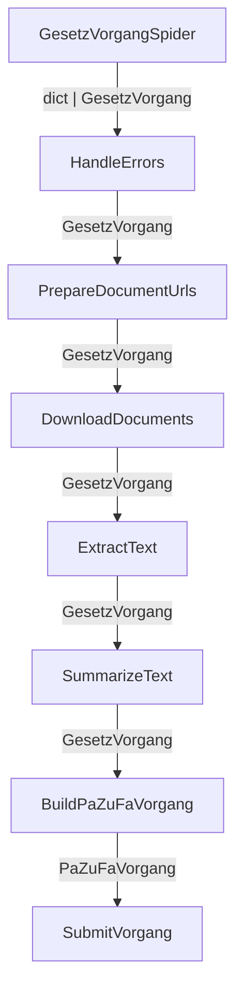

<div align="center">

[](https://www.gnu.org/licenses/gpl-3.0)
&nbsp;&nbsp;
[](https://www.python.org/)
[](https://scrapy.org/)
[](https://pydantic.dev)
&nbsp;&nbsp;
[](https://github.com/astral-sh/uv)
[](https://github.com/astral-sh/ruff)
[](https://github.com/astral-sh/ty)
[](https://github.com/j178/prek)
&nbsp;&nbsp;
[](https://ci.codeberg.org/repos/16670)
[](https://ci.codeberg.org/repos/16670)
&nbsp;&nbsp;
[](https://hub.docker.com/r/sejaeger/pazufa-scraper-be/tags)
[](https://hub.docker.com/r/sejaeger/pazufa-scraper-be/tags)

</div>

---

# `pazufa-scraper-be` — Abgeordnetenhaus von Berlin

A scraper for the [Abgeordnetenhaus von Berlin](https://www.abgeordnetenhaus-berlin.de/) parliament, part of the
[Parlamentszusammenfasser](https://codeberg.org/PaZuFa/parlamentszusammenfasser) (PaZuFa) platform
([pazufa.de](https://pazufa.de)).

Built with [Scrapy](https://scrapy.org/) (crawling & item pipelines), [pydantic](https://docs.pydantic.dev/) (data validation),
[xberg](https://xberg.io/) (PDF extraction), and
[pazufa-corelib](https://codeberg.org/PaZuFa/pazufa-scraper-core) (pazufa backend api client & LLM summaries).

---

## Setup

Requires Python 3.12+.

```bash
uv install
```

## Usage

```bash
# run a spider for current 'wahlperiode'
scrapy runspider pazufa_scraper_be/spiders/gesetz_vorgang.py
```

Using `-s`, you can change scrapy settings.
Check out [the settings.py file](./pazufa_scraper_be/settings.py) for more details.
You might be interested in the following:

| Setting | Default | Description |
| -- | -- | -- |
| `LOG_LEVEL` | `INFO` | Set log level for std out. |
| `WAHLPERIODE` | `19` | Set which wahlperiode to scrape. |

There are a some settings, which activate certain features.

| Setting | Env Var | Default | Description |
| -- | -- | -- | -- |
| `API_TOKEN` | `PAZUFA_API_TOKEN` | `None` | Activates submission to PaZuFa API. Used for authentication and is handed out by backend developer/hoster. |
| `API_URL` | `PAZUFA_API_URL` | `http://localhost:8080` | Required if `API_TOKEN` is set. Used to point to a certain backend/API (local, staging, prod). |
| `LLM_TOKEN` | `PAZUFA_LLM_TOKEN` | `None` | Activates generation of summaries using LLM. |
| `LLM_MODEL` | `PAZUFA_LLM_MODEL` | `openrouter/openai/gpt-5-nano` | Required if `LLM_TOKEN` is set. Choose which model to use from [openrouter.ai](https://openrouter.ai/models?input_modalities=text). |
| `LLM_TIMEOUT` | `PAZUFA_LLM_TIMEOUT` | `300` | Required if `LLM_TOKEN` is set. Timeout for LLM API calls in seconds. |
| `MATTERMOST_TOKEN` | `PAZUFA_MATTERMOST_TOKEN` | `None` | Activates notifications to Mattermost. |
| `MATTERMOST_URL` | `PAZUFA_MATTERMOST_URL` | `https://chat.pazufa.de/hooks` | Required if `MATTERMOST_TOKEN` is set. Mattermost webhook URL. |

For usage via docker see [docker/](./docker/) and [docs](./docker/README.md).

## Development

### Code Hygiene

If you want to make use of git hooks run

```bash
prek install
```

to install and

```bash
prek run --all-files
```

to run all hooks for all files.

For more fine-grained control use

```bash
# linting
prek run ruff-check --all-files
# formatting
prek run formatting --all-files
# type checking
prek run ty --all-files
# testing
prek run test --all-files
```

### Testing

Unit and integration tests are organized as

```text
tests
├── integration
└── unit
    └── pazufa_scraper_be
        ├── conftest.py & helpers.py
        └── {module/}test_{module}.py
```

#### Unit Tests

To run unit tests use

```bash
uv run pytest
uv run pytest tests/unit
```

To get the test coverage run

```bash
uv run pytest --cov
```

or

```bash
uv run pytest --cov --cov-report=html
```

to create a `htmlcov/` directory with the results. Run

```bash
open htmlcov/index.html
```

for an interactive overview.

#### Integration Tests

The objective is to check that the deterministic parts of `ITEM_PIPELINES`, **given the same `xml` feed**, **produce the same output**, for several Vorgänge. Currently the comparison is limited to a comparison of the `PaZuFaVorgang` object.

The current pipelines configuration is



`HandleErrors` to `BuildPaZuFaVorgang` are the pipelines that do the data transformations we want to keep consistent.

To do the integration tests we capture the input and output of each of those pipelines, from `dict | GesetzVorgang` to `PaZuFaVorgang` for a couple of Vorgänge (currently hardcoded to 5) once, for example on `main`, as references and then again during the actual integration test run. And then compare those objects.

To do the persistence and retrieval we use `mlflow` here. To capture capturing snapshot the pipeline input and output objects the `.process_item` methods of the pipelines are wrapper with `mlflow` tracing helpers.

The reference are created using

```bash
uv run python scripts/create_integration_test_references.py
```

This writes the snapshots to `tests/integration-tests-mlflow.db`.

Currently `create_integration_test_references.py` hardcodes what pipelines to include. The script intentionally excludes `SubmitVorgang`, because that pipeline does not produce any output.

The created snapshots can be visually inspected in your browser when you start an mlflow server, e.g. using

```bash
mlflow server \
  --backend-store-uri "sqlite:////absolute/path/above/to/tests/integration-tests-mlflow.db" \
  --host 127.0.0.1 \
  --port 5000
```

`--backend-store-uri` needs to be an absolute path and point to `./tests/integration-tests-mlflow.db`.

The integration test itself is executed using

```bash
uv run pytest -m integration
```

This test failing indicates that some of the produced objects differ from their reference, potentially due to an unexpected side-effect of a change to the logic of one of the pipelines.

The intended workflow is as follows for any intended pipelines changes:

1. Make your changes on your feature branch.
2. Run `uv run python scripts/create_integration_test_references.py` on the `main` branch.
3. Run `uv run pytest -m integration` on your feature branch, comparing against the snapshots from the `main` branch, without your changes.

To visually inspect disagreements between reference and test runs you can use the notebook [`notebooks/test-and-reference-run-diff.ipynb`](./notebooks/test-and-reference-run-diff.ipynb). It let's you inspect the inputs and outputs of each run side by side, highlighting differences.

Note: The integration tests here are conceptual. Hence their implementation is quite limited in scope. An actually spelled out version of integration tests which could be relied on for pipeline development should
- include more fields,
- put tighter constraints on the fields (presence, type),
- test more Vorgang instances than 5 and
- potentially go beyond the comparison of the final `PaZuFaVorgang` objects.
